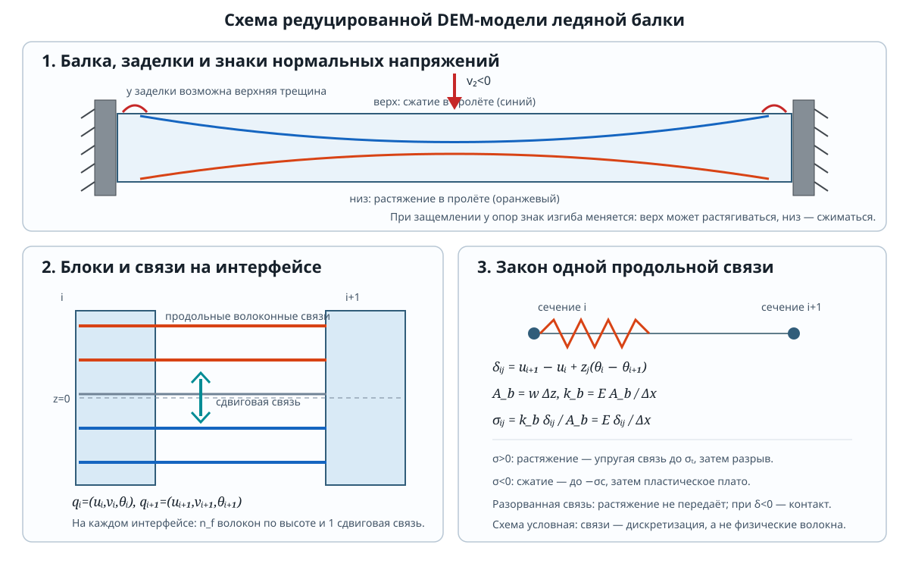
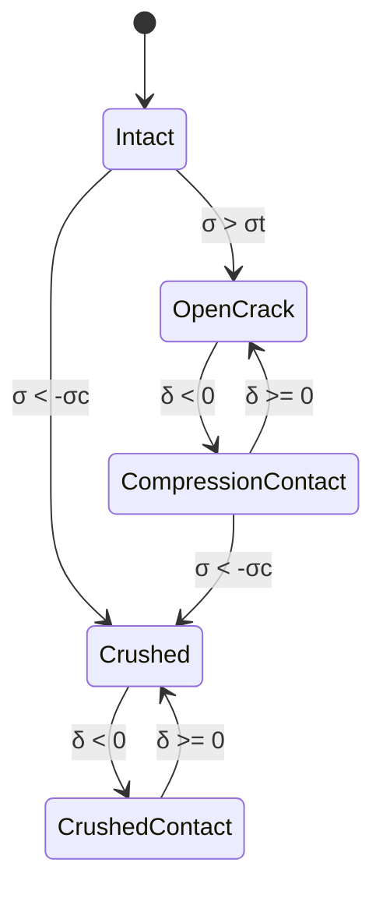

# Математическая модель балки Sodhi

## 1. Что именно рассчитано

Это **квазистатическая 2D block-spring DEM-модель**, а не классическая DEM из
сферических частиц. Балка разбита вдоль пролёта на жёсткие поперечные блоки.
Соседние блоки соединены продольными связями на нескольких уровнях высоты и
одной сдвиговой связью. Поэтому изгиб, растяжение, разрыв и контакт после
разрыва возникают из решения системы дискретных уравнений.

Для воспроизведённого расчёта заданы:

| Параметр | Значение |
|---|---:|
| Пролёт `L` | 1.0 м |
| Высота `h` | 0.10 м |
| Ширина `w` | 0.10 м |
| Модуль Юнга `E` | 9.0 ГПа |
| Коэффициент Пуассона `ν` | 0.30 |
| Предел растяжения `σt` | 0.70 МПа |
| Предел сжатия `σc` | 3.0 МПа |
| Блоки / связи по высоте | 41 / 21 |
| Шаг нагружения | 100 |
| Максимальное перемещение пуансона | 5 мм |

`density = 917 кг/м³` записана в параметрах, но в статическом расчёте не
используется: нет ни инерционных членов, ни веса балки.

## 2. Геометрия дискретизации и степени свободы

У блока `i` есть три степени свободы:

`qᵢ = (uᵢ, vᵢ, θᵢ)`,

где `uᵢ` — продольное перемещение, `vᵢ` — вертикальное перемещение, `θᵢ` —
поворот поперечного сечения. Для `N=41` блоков вектор неизвестных имеет размер
`3N = 123`.

Координата волоконной связи `j` относительно нейтрального слоя:

`zⱼ = -h/2 + (j + 1/2) Δz`,   `Δz = h/nf`,   `j=0,…,nf−1`.

Её представительная площадь и шаг интерфейса:

`Ab = w Δz`,   `Δx = L/(N−1) = 0.025 м`.

У каждого интерфейса соседних блоков есть `nf=21` продольных связей — по одной
на уровень `zⱼ` — и одна сдвиговая связь. Всего 40 интерфейсов. Это связи
дискретной модели; они не означают, что в настоящем льду существуют отдельные
волокна именно такого размера.

## 3. Продольная связь: кинематика, сила и напряжение

В модели принята кинематика жёсткого сечения. Продольное смещение точки на
высоте `z` равно `u − zθ`. Поэтому относительное удлинение связи между блоками
`i` и `i+1`:

`δᵢⱼ = (uᵢ₊₁ − zⱼ θᵢ₊₁) − (uᵢ − zⱼ θᵢ)`

`     = uᵢ₊₁ − uᵢ + zⱼ(θᵢ − θᵢ₊₁)`.

Положительное `δ` означает растяжение; отрицательное — сжатие. Связь имеет
линейную осевую жёсткость

`kb = E Ab / Δx`,

а её осевая сила и номинальное напряжение до повреждения равны

`Nb = kb δ`,   `σb = Nb/Ab = E δ/Δx`.

Удобно записать это через вектор коэффициентов `a` и локальные степени свободы
`qloc = (uᵢ, θᵢ, uᵢ₊₁, θᵢ₊₁)`:

`a = (−1, zⱼ, +1, −zⱼ)ᵀ`,   `δ = aᵀ qloc`.

Внутренняя сила, возвращаемая пружиной в систему равновесия, имеет вид
`kb δ a`; вклад в матрицу жёсткости — `kb a aᵀ`. Упругая энергия связи:

`Ub = 1/2 kb δ²`.

## 4. Сдвиговая связь

Для соседних блоков сдвиговая деформация приближённо вычисляется как

`γ̃ᵢ = (vᵢ₊₁ − vᵢ)/Δx − (θᵢ + θᵢ₊₁)/2`.

Её обобщённое удлинение:

`δs = Δx γ̃ᵢ = vᵢ₊₁ − vᵢ − Δx/2 (θᵢ + θᵢ₊₁)`.

Модуль сдвига, площадь сечения и жёсткость сдвиговой связи:

`G = E/[2(1+ν)]`,   `A = wh`,

`ks = (5/6) G A / Δx`.

Множитель `5/6` — коэффициент сдвиговой коррекции. Для вектора
`(vᵢ, θᵢ, vᵢ₊₁, θᵢ₊₁)` коэффициенты связи равны
`as = (−1, −Δx/2, +1, −Δx/2)ᵀ`; сила — `ks δs as`, жёсткость — `ks as asᵀ`.
Сдвиговые связи в текущем коде всегда упругие: отдельного критерия разрушения
сдвига нет.

## 5. Закон повреждения и контакт после разрыва

Каждая продольная связь имеет дискретное состояние. Знаки напряжений приняты
как в коде: растяжение положительно, сжатие отрицательно.

1. **Целая связь (`intact`).** Работает как пружина `Nb=kbδ`.
2. Если `σb > σt`, связь мгновенно теряет способность передавать растяжение.
   Она удаляется из упругой матрицы — это хрупкий разрыв без постепенного
   смягчения и без накопления энергии разрушения.
3. **Разорванная открытая связь (`open`).** Если `δ≥0`, сила равна нулю:
   трещина не передаёт растяжение.
4. **Контакт разорванной связи (`contact`).** Если после перераспределения
   `δ<0`, связь активируется вновь только на сжатие с той же линейной жёсткостью:
   `Nb=kbδ≤0`. При смене знака `δ` этот контакт открывается и выключается.
5. Если целая связь сжата до `σb < −σc`, или уже замкнутая трещина достигает
   того же порога, она переходит в состояние `crushed`. Сжатая раздавленная
   связь моделирует идеально-пластическое плато:
   `Nb=−σc Ab`, если контакт закрыт; при открытом контакте `Nb=0`.
   Касательная жёсткость раздавленной связи в решателе равна нулю.

Такое правило — односторонний пружинный контакт, а не геометрический расчёт
столкновения двух граней частиц. В модели нет коэффициента трения, контактного
зазора, дробления с уплотнением или сдвигового разрушения.

### Схема переходов состояния

Для раздавленной связи переход `Crushed ↔ CrushedContact` меняет только
активность контактной силы; разрушенное состояние не восстанавливается.

## 6. Система равновесия

Соберём все свободные перемещения и повороты в `qf`, а предписанные — в `qp`.
Последние включают закреплённые степени свободы и перемещение пуансона. Для
каждой активной линейной связи `r` с вектором коэффициентов `ar` и жёсткостью
`kr` вклад в глобальную матрицу:

`Kr = kr ar arᵀ`.

Сумма по действующим волоконным пружинам, односторонним контактам и сдвиговым
связям даёт `K`. Для предписанных/свободных степеней свободы её блоки
обозначаются `Kff` и `Kfp`. Раздавленные связи дают заданные постоянные силы
`Nc = −σc Ab` и вектор их узловых вкладов `fc`.

Свободные степени свободы на каждом шаге удовлетворяют:

`Kff qf + Kfp qp + fc + κ(qf − qref) = 0`,

или

`(Kff + κI) qf = −Kfp qp − fc + κ qref`.

Здесь `qref` — положение свободных степеней свободы на начале текущего шага, а
`κ = 10⁻¹⁰ Ewh` — очень слабая численная пружина. Она удерживает блоки,
оказавшиеся отсоединёнными разрывами, около их предыдущего положения и убирает
нулевые моды. Это численная стабилизация, а не физическая связь балки с
основанием.

Если множество активных контактов и разрушений зафиксировано, уравнение
линейно; оно решается методом сопряжённых градиентов с диагональным
предобуславливанием. После решения знаки напряжений/удлинений перепроверяются,
поскольку изменение контакта меняет матрицу и разрушение меняет топологию.

## 7. Закрепления, нагрузка и вычисление реакции

Оба крайних блока защемлены: `u=v=θ=0` слева и справа. Центральному блоку
предписано вертикальное перемещение вниз:

`vcenter = −d`.

Это **нагружение по перемещению**, а не заданная сила: в расчёт заранее не
задаётся `F`. После решения сила пуансона восстанавливается как реакция в его
предписанной степени свободы — сумма вертикальных компонент обобщённых сил
связей, приложенных к этому DOF. В CSV и графике показывается модуль реакции.
Собственный вес не включён.

Шаги плотнее распределены около ожидаемого разрушения. Оценка перемещения
начала трещины из формулы прогиба идеально упругой заделанной балки:

`dest = σt L²/(12 E h)`.

Затем код задаёт `dcr=min(dmax,1.5 dest)` и
`dc=min(dmax,max(dcr,1.5 dest σc/σt))`, выделяет примерно треть шагов до `dcr`,
треть до `dc` и оставшиеся шаги до `dmax`. Это только схема выбора размера шага;
трещина всё равно определяется локальным напряжением дискретной модели.

## 8. Что выполняется на каждом шаге

1. Установить очередное заданное `d` пуансона; крайние блоки оставить
   неподвижными.
2. По предыдущей конфигурации отметить ранее повреждённые связи, у которых
   `δ<0`, как активные сжатые контакты.
3. Собрать матрицу жёсткости для целых волокон, активных линейных контактов и
   всех сдвиговых связей; добавить постоянные силы раздавленных контактов и
   слабую численную стабилизацию.
4. Решить линейное равновесие методом сопряжённых градиентов.
5. Посчитать `σb=Eδ/Δx` у целых волокон. Связи, превысившие `σt` на растяжение
   или `σc` на сжатие, изменить на разорванные/раздавленные.
6. Если состояние хоть одной связи изменилось, повторить сборку и решение
   **при том же перемещении пуансона**: усилия перераспределяются по оставшимся
   связям.
7. Когда новые разрушения больше не возникают, обновить активный набор
   односторонних контактов; при изменении набора снова решить равновесие.
8. Вычислить реакцию пуансона, сохранить перемещение, силу и состояния связей;
   перейти к следующему шагу.

Таким образом, на анимации показана последовательность равновесных состояний,
а не движение во времени: инерция и скорость разрушения не моделируются.

## 9. Критерий глобального обрушения и его вывод

Срабатывание одной связи — критерий **начала локального повреждения**, но не
ответ на вопрос, выдерживает ли балка нагрузку целиком. Для оценки глобального
предела используем идеализированный пластический механизм балки с тремя
шарнирами: у двух заделок и в середине пролёта. Это отдельный критерий предельной
несущей способности, а не утверждение, что сами пружины DEM являются
пластическими шарнирами.

### Предельный момент с разными прочностями при растяжении и сжатии

Пусть `a` — глубина сжатой зоны прямоугольного сечения, а напряжения в
предельном состоянии равны `σc` в сжатой зоне и `σt` в растянутой. Результирующая
продольная сила в чистом изгибе должна быть нулевой:

`N = w σc a − w σt(h − a) = 0`,

откуда

`a = σt h/(σt + σc)`.

Момент относительно нейтральной оси равен сумме моментов двух прямоугольных
диаграмм напряжений:

`Mp = w σc a²/2 + w σt(h − a)²/2`

`   = w h² σt σc / [2(σt + σc)]`.

### Работа трёхшарнирного механизма

При вертикальном перемещении середины `δ` каждая половина балки поворачивается
на малый угол `θ ≈ 2δ/L`. У двух концевых шарниров суммарная пластическая работа
`2 Mp θ`; относительный поворот в центральном шарнире равен `2θ`, его работа —
`2 Mp θ`. Виртуальная работа внешней силы `F`:

`F δ = 4 Mp θ = 4 Mp(2δ/L)`,

поэтому

`Fu = 8 Mp/L = 4 w h² σt σc / [L(σt + σc)]`.

В расчёте глобальный критерий срабатывает на первом шаге, где реакция
перемещения достигает `Fu`:

`max(F_i) ≥ Fu`.

Это предел **несущей способности при управлении силой**: выше него механизм
идеальной пластичности не имеет статического равновесия. Текущий численный DEM
нагружает балку перемещением, поэтому может перескочить через этот уровень за
один шаг; в CSV/JSON сохраняется первое пересечение. Красная линия на графике
показывает `Fu`, отметка — первый расчётный шаг, достигший критерия.

Чтобы визуализировать полную потерю несущего пути после этого события,
демонстрация вводит дополнительную **идеализацию катастрофического разрыва**:
мгновенно удаляются все продольные и сдвиговые связи на двух интерфейсах,
примыкающих к центральному (нагружаемому) блоку. Нагружаемый блок становится
отсоединённым от обеих половин балки, поэтому следующая реакция пуансона равна
нулю. После этого выполняются пятьдесят дополнительных шагов визуализации
перемещения до 5 мм или ещё на `0.05h` после точки обрушения — выбирается
большее значение. Форма обеих частей балки фиксируется на последнем кадре до
обрушения; перемещается только отсоединённый центральный блок.

Этот искусственный разрез **не следует из одного только трёхшарнирного
критерия**: он введён для изображения полной утраты контакта с пуансоном и
падения силы до нуля. Инерционное падение частей балки и распространение
трещины не рассчитываются; повторное статическое решение после отсоединения
не выполняется, так как оно не описывает динамическое снятие напряжений и может
дать неустойчивое перемещение свободных частей. Стрелки напряжений на
постразрушительных кадрах скрыты.

Для `L=0.25 м`, `h=w=0.1 м`, `σt=0.7 МПа`, `σc=3 МПа` получаем
`a≈0.01892 м`, `Mp≈283.78 Н·м` и `Fu≈9.08 кН`. Это не совпадает с ранее
показанным DEM-откликом, который давал реакции заметно выше этой оценки: модель
связей с идеально-пластическим сжатием не формирует явно три пластических
шарнира. Поэтому новый критерий используется как внешний предел; искусственный разрез
явно отделён от собственного прогноза пружинной DEM.

Первое растягивающее разрушение и глобальное обрушение — разные события.
Справочные выражения Sodhi `Ff = 4 σt w h²/(3L)` и
`Fc = 8 σc w h²/(9L)` при `β=1/3` остаются отдельными аналитическими
сравнениями; `Fu` выше получено из явно указанного трёхшарнирного механизма.

## 10. Интерпретация и ограничения

Первое повреждение может появиться возле заделки, а не под пуансоном: у
защемлённой балки изгибающий момент около опоры меняет знак относительно
середины пролёта. Цветные ячейки показывают **знак/состояние дискретной
продольной связи**, а не восстановленное непрерывное поле напряжений FEM.
Деформация в анимации увеличена в 4 раза. Редкие стрелки показывают дискретное
продольное нормальное напряжение `σx`: вправо для `σx>0` (растяжение), влево
для `σx<0` (сжатие). Это не полный тензор напряжений; сдвиговые напряжения
стрелками не отображаются.

Трёхшарнирная оценка предполагает идеализированные равномерные предельные
диаграммы, симметричное сечение и отсутствие влияния сдвигового разрушения,
скорости нагружения и инерции. Для прогноза физического послекритического
обрушения нужны экспериментально заданная энергия разрушения/закон смягчения и
модель динамического разрушения. Также необходимы сеточная сходимость,
калибровка контакта и сравнение с экспериментом.

Исходная реализация: [`dem_sodhi.py`](./dem_sodhi.py). Результаты расчёта:
указываются в `summary.json`, `force_displacement.csv` и `beam_animation.html`
папки, переданной параметром `--output`.
